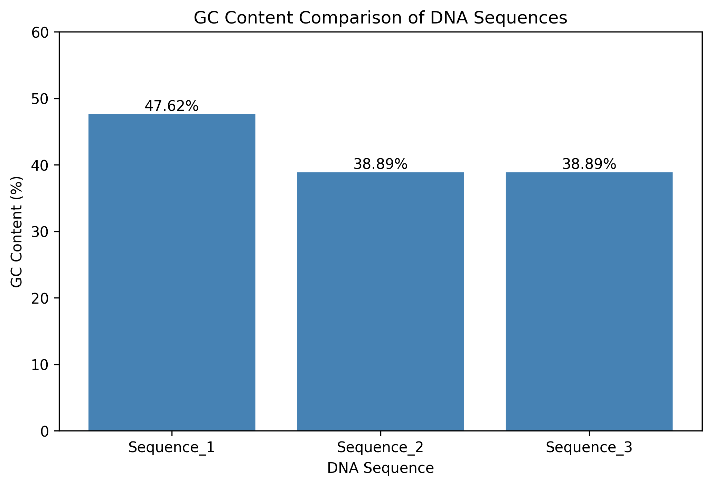

# DNA Sequence Analyzer Using Biopython

## Project Overview

This project demonstrates fundamental bioinformatics sequence analysis using Python and Biopython. It processes DNA sequences stored in FASTA files, calculates sequence lengths and GC content, performs DNA transcription and translation, and visualizes results using Matplotlib.

The project was developed in Google Colab as a hands-on exercise in biological sequence processing and Python-based data analysis.

## Objectives

- Read and write FASTA files using Biopython.
- Calculate DNA sequence lengths and GC content.
- Perform DNA-to-RNA transcription.
- Translate coding sequences into amino acid sequences.
- Analyze multiple DNA sequences automatically using Python loops.
- Organize sequence results into pandas DataFrames.
- Export analysis results to CSV files.
- Visualize GC content differences using Matplotlib.

## Tools and Technologies

- **Python** — Sequence processing and automation
- **Biopython** — Biological sequence manipulation and FASTA processing
- **pandas** — Data organization and CSV export
- **Matplotlib** — Data visualization
- **Google Colab** — Interactive Python development
- **GitHub** — Project documentation and version control

## Project Workflow

1. Created example DNA sequences using Biopython's `Seq` class.
2. Calculated nucleotide lengths and GC percentages.
3. Transcribed DNA into RNA and translated coding sequences into amino acids.
4. Created and read FASTA files using `SeqRecord` and `SeqIO`.
5. Processed multiple DNA sequences using a Python `for` loop.
6. Organized results into a pandas DataFrame.
7. Exported results to CSV and generated a GC content comparison chart.

## Results

| Sequence ID | Length (bp) | GC Content |
|---|---:|---:|
| Sequence_1 | 21 | 47.62% |
| Sequence_2 | 18 | 38.89% |
| Sequence_3 | 18 | 38.89% |

Sequence_1 had the highest GC content among the three example sequences.

### GC Content Visualization

## Repository Files

| File | Description |
|---|---|
| `DNA_Sequence_Analyzer_Biopython.ipynb` | Complete Google Colab notebook containing the analysis code |
| `sample_dna.fasta` | Single example DNA sequence |
| `multiple_sequences.fasta` | Three example DNA sequences |
| `DNA_Sequence_Analysis_Report.txt` | DNA sequence analysis report |
| `DNA_Sequence_Analysis_Results.csv` | Tabular sequence analysis results |
| `GC_Content_Comparison.png` | GC content comparison chart |

## How to Run

1. Download or clone this repository.
2. Open `DNA_Sequence_Analyzer_Biopython.ipynb` in Google Colab or Jupyter Notebook.
3. Install Biopython if necessary:

   `pip install biopython`

4. Run the notebook cells in order to reproduce the analysis and output files.

## Limitations

This project uses short, artificial DNA sequences for educational purposes rather than experimentally validated gene sequences.

Protein translation assumes an appropriate coding sequence and reading frame. The results are intended to demonstrate fundamental sequence-analysis techniques, not to support biological or clinical conclusions.

## Skills Demonstrated

Python programming, Biopython, FASTA file handling, DNA sequence analysis, GC content calculation, transcription, translation, loops, pandas DataFrames, CSV processing, and scientific data visualization.

## Future Improvements

- Analyze longer DNA sequences from public biological databases.
- Add sequence validation and error handling.
- Support larger multi-FASTA datasets.
- Generate automated summary statistics and additional visualizations.
